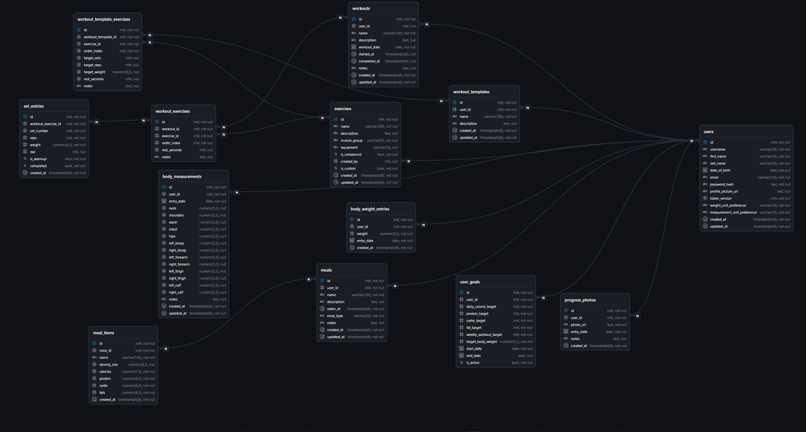

# Fitness Performance Tracker

A Python 3.13+ backend built with FastAPI and PostgreSQL for tracking fitness and nutrition.

The API supports authentication and profiles, goals, exercises, workouts, workout
exercises, and meals. Set entries, meal items, body measurements, body-weight entries,
and progress photos have database support but are not yet exposed through the API.
The frontend is a placeholder.

## Setup

Requires Python 3.13+ and PostgreSQL. Run commands from the repository root.

1. Create a virtual environment:

   ```bash
   python -m venv .venv
   ```

   Activate it with `.venv\Scripts\Activate.ps1` in PowerShell or
   `source .venv/bin/activate` on macOS/Linux.

2. Install dependencies:

   ```bash
   python -m pip install -r requirements.txt
   ```

3. Copy [.env.example](.env.example) to `.env`. Set the database connection values
   and replace `JWT_SECRET_KEY` with your own secret.

4. Create the database in PostgreSQL:

   ```sql
   CREATE DATABASE fitness_performance_tracker;
   ```

5. Initialize the schema and seed data:

   ```bash
   python -m data.init_db
   ```

   This drops and recreates the `public` schema by default. Use `--no-reset` to
   skip that step and `--no-seed` to skip seed data.

6. Start the API:

   ```bash
   uvicorn main:app --reload
   ```

API documentation: [Swagger UI](http://127.0.0.1:8000/docs) or
[ReDoc](http://127.0.0.1:8000/redoc).

## Code Structure

| Directory | Purpose |
| --- | --- |
| `routers/` | HTTP endpoints |
| `services/` | Business rules and ownership checks |
| `ports/` | Repository and unit-of-work protocols |
| `repositories/` | SQL execution and persistence |
| `data/` | SQL files, query loading, row mappers, validation, and transactions |
| `schemas/` | Pydantic request and response models |
| `dependencies/` | Dependency providers, authentication, and pagination |
| `auth/` | Password hashing and JWT handling |
| `core/` | Configuration, logging, and centralized error handling |
| `utils/` | Shared helpers |
| `tests/unit/` | Tests grouped by application responsibility |

Services depend on repository protocols; `dependencies/providers.py` supplies
implementations. HTTP error mappings live in `core/exception_handlers.py`.

Queries live in `data/sql/<entity>/<operation>.sql` and are registered in
`data/queries.py`. Bind runtime values through `%s` parameters; dynamic SQL
structure must use whitelisted columns. Include the SQL files when deploying and
restart the process after editing cached queries.

Row conversion belongs in `data/mappers/`, using the shared helpers in
`data/validation.py`. Goal writes use the unit of work in `data/unit_of_work.py`
with explicit commits, rollback on failure, and a user-row lock to serialize
changes to active goals.

List endpoints use `limit=100` and `offset=0` by default. Limits must be from 1
to 1000; offsets must be nonnegative.

## Tests

Run the database-independent suite:

```bash
python -m unittest discover -s tests -v
```

Run one module:

```bash
python -m unittest tests.unit.services.test_user_goals_service -v
```

Shared model fixtures live in `tests/fixtures.py`. Database execution is mocked;
PostgreSQL constraints, locking, and concurrent writes require integration tests.

Optional development tools:

```bash
python -m pip install ruff coverage
python -m ruff check .
python -m coverage run --branch --source=services,auth,schemas,utils.validators -m unittest discover -s tests
python -m coverage report -m
```

The coverage command measures only the listed modules.

For manual API testing, import the
[Postman collection](postman/Fitness-Performance-Tracker.postman_collection.json).

## Logging

`LOG_LEVEL` defaults to `INFO`. Set `LOG_FILE` to enable file output, rotating at
10 MiB with five backups. Relative log paths resolve from the working directory.
API startup and the database bootstrap configure logging through
`core/logging_config.py`.

## Database

The schema is defined in [data/schema.sql](data/schema.sql).


